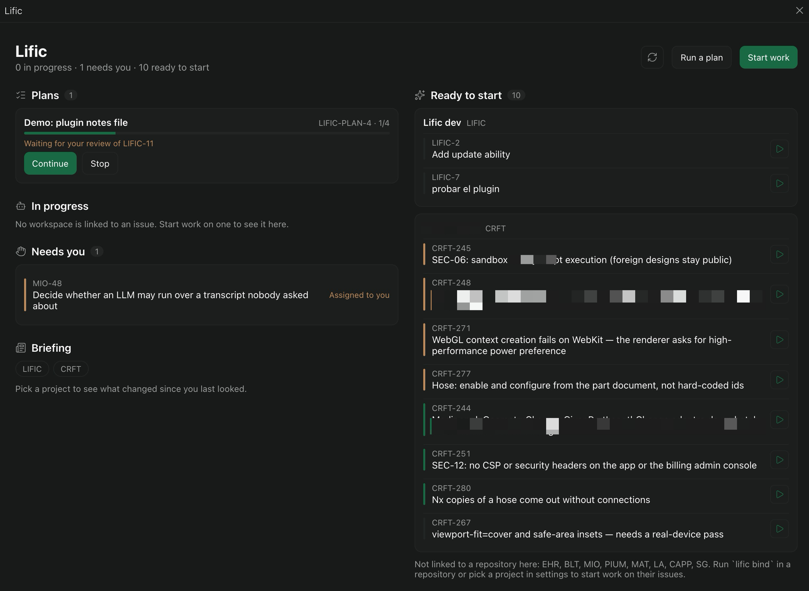
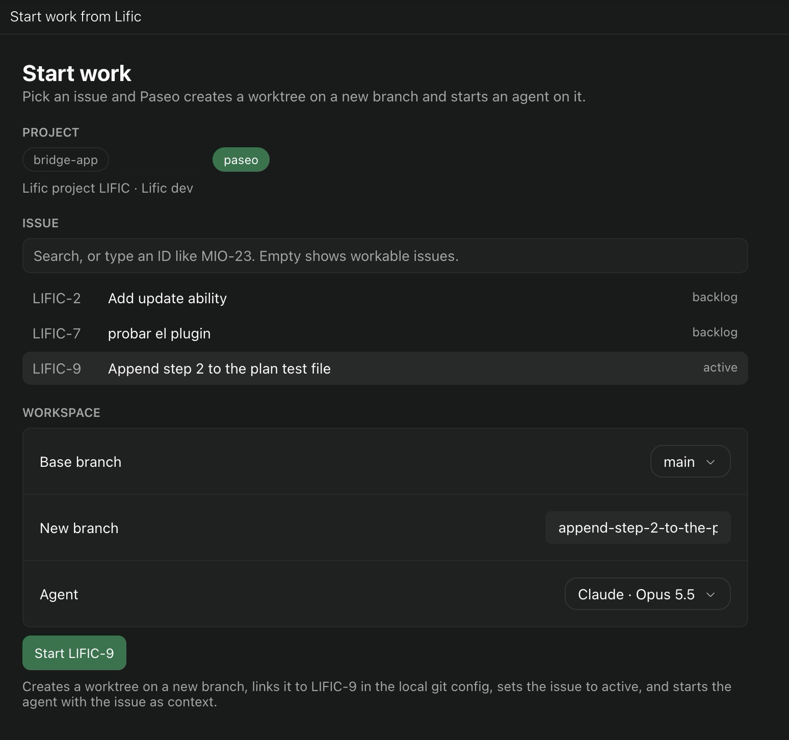
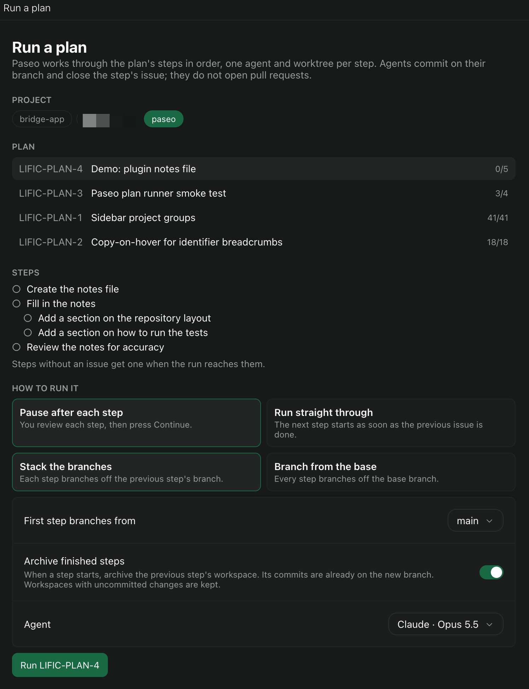

# Lific for Paseo

A [Paseo](https://paseo.sh) plugin that connects [Lific](https://github.com/VoidNullable/lific) to your agents: start work from an issue, give agents the issue as context, follow the issue from the workspace, and run Lific plans step by step. See [OVERVIEW.md](OVERVIEW.md) for what it does and how it stores data.



| Start work from an issue | Run a plan |
| --- | --- |
|  |  |

## Requirements

- Paseo 0.12 or newer
- Lific 2.11 or newer
- git on the daemon host

## Install

```bash
paseo plugin add git:lardissone/paseo-lific
```

Plugins run unsandboxed on the daemon host. Read the code before you install it.

Then, in Lific, create a bot for a tool named `paseo` and copy its API key. In Paseo, open **Settings → Plugins → Lific** and enter your Lific URL and the key.

## Develop

```bash
npm install
npm run typecheck
npm test
paseo plugin install "$PWD"
paseo plugin reload lific   # after each change
paseo plugin logs lific
```

Layout follows the Paseo plugin runtimes:

| Path | Runs in | Contents |
| --- | --- | --- |
| `index.client.tsx`, `client/` | Paseo app (iOS, Android, web, desktop) | Screens, panel, timeline cards, form state |
| `index.server.ts`, `server/` | Daemon subprocess | Lific client, git state, hooks, plan runner |
| `shared/` | Both | RPC contracts, settings, Lific models, run vocabulary |

Tests use real git repositories in temporary directories and run the real Lific client against in-memory servers.
